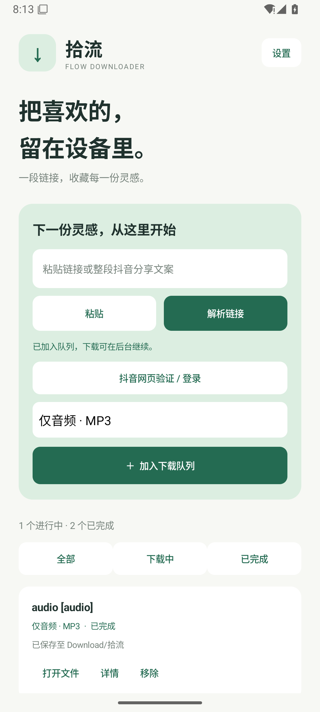

# 拾流 · Flow

基于 **yt-dlp** 的中文视频下载应用。macOS 使用 SwiftUI 原生窗口；Android 使用 Kotlin 原生界面、前台服务和 MediaStore。没有云端服务，视频直接保存到设备。

| 平台 | 界面 | 系统要求 |
| --- | --- | --- |
| macOS | SwiftUI 原生桌面应用 | macOS 13+ |
| Android | Kotlin 原生应用 | Android 10+ |

支持视频解析、画质选择、MP3 提取、下载队列、暂停续传和历史记录。macOS 和 Android 均支持整段抖音分享文案与官方网页登录 / 验证。

<details>
<summary>查看 Android 实际界面</summary>



</details>

## 下载安装包

| 平台 | 安装包 | 说明 |
| --- | --- | --- |
| Android | [下载 1.0.1 APK](https://github.com/CnRiven/flow-downloader/releases/download/v1.0.1/Flow-Android-1.0.1-debug.apk) | Android 10+；测试签名，可覆盖安装之前的测试版 |
| macOS | [下载 1.0.5 应用 ZIP](https://github.com/CnRiven/flow-downloader/releases/download/v1.0.5/Flow-macOS-1.0.5-arm64.zip) | Apple Silicon，macOS 13+；缺少 yt-dlp 时自动安装 |

[Mac 1.0.5 发布说明、源码与校验值](https://github.com/CnRiven/flow-downloader/releases/tag/v1.0.5) · [Android 1.0.1 发布说明](https://github.com/CnRiven/flow-downloader/releases/tag/v1.0.1)。安装包为预览版，macOS 应用尚未进行 Apple 公证。

## macOS 1.0.5：修复登录后仍无法下载抖音视频

旧版保存 Cookie 后仍调用常规解析，遇到 `blob:` 播放器又无法取得实际视频地址。新版读取网页播放响应、首屏渲染数据和当前播放器组件中的普通媒体地址，并核对当前视频 ID。

使用失败任务的「抖音登录 / 验证后重试」入口，在网页播放目标视频，点击「读取网页视频并下载」，或在出现「使用已识别视频」后直接使用。视频已识别时，保存按钮也会转交网页视频地址；仅保存登录状态时会保留窗口，提示播放视频再读取，避免重复登录重试。

真实示例 `7651105998492519707` 已完成下载：1440 × 1080，H.264 视频与 AAC 音频，时长约 16 分 51 秒，文件 178,809,979 字节。回归检查涵盖真实 WebKit 中的 Fetch、XHR、首屏渲染、播放器组件、相关视频隔离和页面内导航。加密流仍不支持；网页提供的普通媒体地址即使由 `blob:` 播放器使用，也可读取。

## macOS 1.0.4：抖音分享文案与网页登录

可粘贴整段「复制此链接，打开抖音」分享文案，应用会提取其中的视频网址，将抖音短链接和 `iesdouyin.com/share/video`、`xg/video`、`modal_id` 页面转换为标准视频地址。

抖音任务旁和偏好设置中新增「抖音登录 / 验证」：在可见的官方网页中手动完成登录或验证，点击「保存状态并重试」。网页登录状态保存在本机 WebKit 中，只有主动保存后才向抖音任务提供 Cookie；可以在设置中清除。应用不代填或记录密码。

若常规解析仍失败，可在官方网页播放目标视频，点击「使用当前视频」。这会使用当前页面可见播放器的 HTTPS 视频地址，绑定当前视频 ID，临时保留 10 分钟；加密流及仅允许在抖音 App 内播放的内容暂不支持；1.0.5 补充了普通媒体的 blob 播放器适配。选择网页视频时使用页面提供的单文件，清晰度取决于该播放器。

检测到缺少新的网页状态或登录要求时，错误弹窗和失败任务会提供登录、验证后重试的入口。临时 Cookie 和视频元数据文件使用私有权限，并在请求结束后删除；不写入任务历史，不用于其他站点。站点风控、账号权限及网络状况仍会影响下载结果。

## macOS 1.0.3：进度与交互优化

- 视频和音频轨道合并计算整个任务的进度；切换轨道、更新预估大小或断点续传时不会倒退。传输最多显示 95%，合并、转换和文件检查完成后才显示 100%。未知大小的下载显示等待动画。
- 解析立即显示忙碌状态、已等待时间和取消入口；连续点击只启动一次，未修改链接与浏览器选项时复用已获取的预览。
- 加入队列立即创建任务并关闭弹窗，检查引擎和获取视频信息在后台继续；可以在解析期间直接提交。相同链接、格式、目录和浏览器选项的未完成任务不会重复添加。
- 减少进度刷新触发的历史文件写入，任务完成、暂停和退出时立即保存。

## macOS 1.0.2：自动安装下载引擎

首次启动会检测可运行的 yt-dlp；如果没有安装，或现有安装无法运行，拾流会自动从 yt-dlp 官方 GitHub 发布下载 macOS 独立引擎。无需先安装 Homebrew、Python 或输入管理员密码，也不需要 GitHub 登录。

引擎保存在 `~/Library/Application Support/Flow/engines/bin/yt-dlp`，优先使用这个路径。安装会显示进度，校验 SHA-256 并运行版本检查；失败或取消不会覆盖原有可用引擎。可以在偏好设置中重试、更新或修复。安装期间发起的解析或加入队列操作，会在引擎就绪后继续。

首次安装需要访问 GitHub。FFmpeg 和 Deno 仍是独立的可选组件：缺少 FFmpeg 时，视频优先选择带声音的单文件格式；MP3 转换、分离音视频合并仍需 FFmpeg，部分 YouTube 功能需要 Deno。

## 获取项目

```sh
git clone https://github.com/CnRiven/flow-downloader.git
cd flow-downloader
```

仓库提供应用源码、构建脚本、许可证和测试。安装包在 GitHub Releases 中提供，本机开发工具不纳入 Git 历史。也可以克隆仓库后，按下文的「构建 macOS」或「构建 Android」自行生成安装包。

## Android 1.0.1（2026-11-05）

安装 `dist/Flow-Android-1.0.1-debug.apk`，可以直接覆盖安装 1.0.0 并保留任务记录。

- 内置 yt-dlp 从 2025.11.12 更新到 **2026.10.26**。首次打开会升级旧安装的引擎；已经手动更新到更高版本的引擎会保留。安装升级不需要先连接 GitHub。
- 可直接粘贴整段抖音分享文案，例如 `6.97 复制打开抖音… https://v.douyin.com/Oth-A-XmqqQ/ …`，也支持 Android 分享菜单和 Markdown 链接。
- 抖音短链接先展开，再将 `iesdouyin.com/share/video/...`、`iesdouyin.com/xg/video/...` 等地址转换为可识别的视频地址。
- 新增「抖音网页验证 / 登录」。需要验证时，在官方网页完成验证或登录，然后点击「保存验证状态」返回重试；状态只保存在本机。
- 若官方网页能够播放目标视频，也可选择「使用当前视频」，返回后加入队列。此模式保存当前播放源，画质以网页实际播放源为准。链接缓存有效期为 10 分钟，过期时重新打开网页选择视频。
- 错误弹窗改为简短中文提示，原始日志保留在「详细信息」中。

抖音可能要求手动完成验证码或登录；如果官方网页不能播放、仍要求验证，不能保证该视频可下载。本次测试中，给定视频在测试网络上仍要求官方验证，没有宣称已绕过验证或成功下载该公开视频。

## 直接使用

- macOS：打开 `dist/拾流.app`，或解压 `dist/Flow-macOS.zip` 后拖到「应用程序」。当前构建为 **Apple Silicon / macOS 13+**。
- Android：安装 `dist/Flow-Android-1.0.1-debug.apk`（`dist/Flow-Android-debug.apk` 同步为最新版）。支持 **Android 10+**，包含 arm64-v8a、armeabi-v7a、x86_64。此为开发测试包，非商店发布版。

macOS 版本会自动准备 yt-dlp，也可识别本机已有的安装。需要合并音视频、提取 MP3 或完整 YouTube 脚本支持时，可安装可选组件：

```sh
brew install ffmpeg deno
```

macOS 包使用本地临时签名，尚未进行 Apple Developer ID 签名、公证。若系统拦截外部下载的应用，在系统设置的「隐私与安全性」中检查并允许打开。Android 包内含下载运行时，无需安装 Python 或 Termux。

## 使用方法

1. 粘贴视频链接或整段分享文案，点击「解析链接」。也可跳过解析，直接加入队列。
2. 选择最佳画质、1080p、720p 或 MP3。清晰度是上限，具体取决于视频源；视频容器优先 MP4，必要时使用 MKV。
3. 加入下载队列，查看进度，暂停或继续。断点续传取决于服务器是否支持以及源链接是否仍有效；某些片段或后处理步骤需要重新开始。
4. 在已完成任务中打开文件。Mac 可在 Finder 中定位文件。

macOS 默认保存到 `~/Downloads/拾流`，可更改目录；Android 保存到系统 `Download/拾流`，不会申请「所有文件访问」权限。Android 支持从其他应用的「分享」菜单接收视频链接。

每个任务只下载一个视频。视频与列表混合链接优先使用当前视频；纯播放列表链接只取第一项，参数为 `--no-playlist --playlist-items 1`。Mac 最多同时下载两个任务，新加入的任务优先排队；Android 依次下载。退出或进程中断后，未完成任务恢复为暂停状态，需要手动继续。移除记录保留已经下载的成品文件，并清理该任务的临时文件。

## 站点与登录

站点解析、画质和格式由 yt-dlp 提供，实际可用性还受站点变化、网络、登录状态和视频权限影响。这里没有承诺所有站点、所有链接都能下载，也没有添加 DRM 解密。

Mac 设置中可主动选择从 Safari、Chrome、Firefox 或 Edge 读取登录 Cookie，默认关闭；系统可能要求浏览器、钥匙串或文件访问权限。浏览器 Cookie 由本机 yt-dlp 读取，不上传。Mac 1.0.4 的内置抖音网页登录状态保存在本机 WebKit；主动保存后，任务临时 Cookie 文件使用私有权限并在结束后删除。已排队任务保留创建时的浏览器选项，修改设置只影响新任务。Android 1.0.1 通过内置的官方抖音网页保存验证 Cookie，保存在应用私有目录，并仅用于抖音请求。

Mac 在偏好设置中选择「更新 / 修复 yt-dlp」；如果选择维护 Homebrew 安装，也可运行 `brew upgrade yt-dlp`。Android 在设置中选择「更新下载引擎」。原生 Android 运行时、FFmpeg 等组件随 APK 更新。

## 构建 macOS

需要 Apple Command Line Tools 或 Xcode，不依赖第三方 Swift 包。

```sh
bash scripts/build-macos.sh
open dist/拾流.app
```

脚本按当前 Mac 架构编译，制作图标、应用包和 ZIP。在 Intel Mac 上运行脚本可构建 Intel 版本；当前提供的二进制为 arm64。

## 构建 Android

使用 Android Studio 打开 `android/`，或准备 JDK 17、Android SDK 35 / Build Tools 35.0.0 后运行：

```sh
cd android
./gradlew :app:assembleDebug :app:testDebugUnitTest
```

产物位于 `android/app/build/outputs/apk/debug/app-debug.apk`。AGP 8.9.2、Gradle 8.11.1、Kotlin 2.1.20、youtubedl-android 0.18.1 已固定版本。本工作区的临时工具位于 `.tools/`，机器专属 SDK 路径位于忽略提交的 `android/local.properties`。

下载在 `dataSync` 前台服务中执行。Android 系统的服务限时、电量管理或用户强制停止可能中断下载；下次启动后手动继续即可。服务运行期间显示下载通知，Android 13+ 可选择授予通知权限。

## 验证

```sh
swift run FlowChecks
python3 scripts/integration-test.py
cd android && ./gradlew :app:testDebugUnitTest :app:lintDebug
```

`FlowChecks` 是可直接运行的 Swift 核心测试，不要求 Command Line Tools 中未提供的 XCTest。集成脚本先由 FFmpeg 生成带声音的本地 MP4，再通过临时 HTTP 服务测试真实 yt-dlp 的解析、视频下载和 MP3 提取；不会下载第三方视频。

自动检查还覆盖 URL 与命令参数安全、结构化进度、中文路径、大型元数据、错误输出、取消进程、损坏历史文件和任务恢复。集成测试会打断真实下载，验证 HTTP Range 续传和最终文件逐字节一致性。Mac 界面可运行并检查；Android 是否经过真机验证以交付说明为准，成功生成 APK 不等于已通过所有设备兼容性测试。

Android 1.0.1 已在 Android 15 / arm64 模拟器中验证从旧版升级、保留历史、新版原生引擎执行、视频解析下载、MP3 转换和 MediaStore 导出。可在专用测试模拟器中运行 `scripts/android-smoke-test.py --adb /path/to/adb --port 5037 --legacy-apk /path/to/1.0.0.apk`。该脚本会覆盖安装应用并写入测试历史，请仅用于可丢弃的测试模拟器。

`bash scripts/check-macos-model.sh` 验证解析连续点击、缓存复用、取消和链接修改、解析期间立即入队、队列去重、等待引擎时暂停及重复恢复。`python3 scripts/macos-smoke-test.py` 使用隔离数据目录运行实际应用，验证首次启动时直接入队和重启后解析；该脚本需要本地 FFmpeg 生成测试文件，默认从官方安装引擎，也可通过 `--engine /path/to/yt-dlp` 复用已有独立引擎。

Mac 自动安装检查覆盖校验失败、版本错误、非官方地址、路径穿越、取消、断网、重复校验记录以及已有安装保留。实际 GUI 检查在隔离数据目录、空的系统工具搜索路径中执行了首次启动、官方独立引擎安装、安装后继续解析和下载、再次启动复用引擎；还在仅包含 `/usr/bin:/bin` 的环境中验证了独立引擎无需外部 Python 即可运行。

## 项目结构

```text
Sources/Flow/             SwiftUI 界面、任务队列、设置
Sources/FlowCore/         进程管理、yt-dlp 参数、状态与持久化
Tests/FlowCoreChecks/     可运行的核心检查
android/app/             Kotlin 界面、下载服务、存储
scripts/                 打包、图标和集成验证
dist/                    本地应用、APK 和截图（不纳入源码）
```

## 开源许可

应用代码采用 **GPL-3.0-or-later**。第三方组件单独遵循其许可证，见 `LICENSE` 和 `THIRD_PARTY_NOTICES.md`。技术依据：

- yt-dlp：https://github.com/yt-dlp/yt-dlp
- Android 运行时封装：https://github.com/yausername/youtubedl-android
- FFmpeg：https://ffmpeg.org/

当前产物供本地开发和试用。对外分发前，需要为确切的二进制依赖整理对应源码及完整许可证，并完成平台签名、公证和设备测试。
